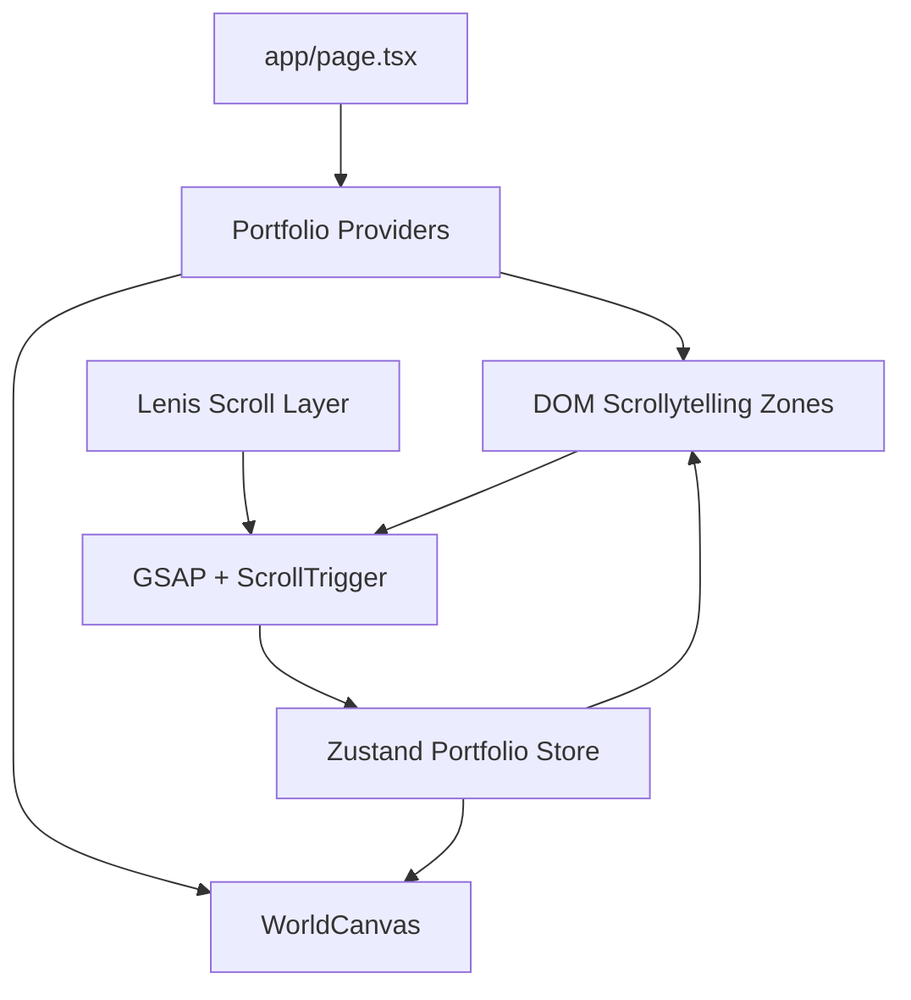
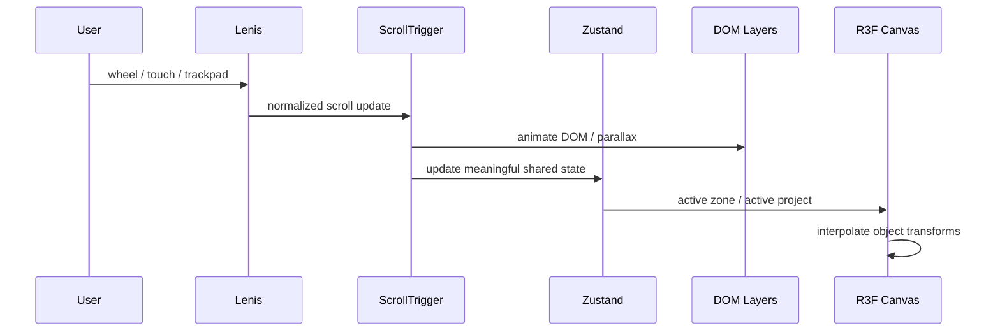

# ARCHITECTUR — Technical Architecture

**Project:** Zidan Khainur Interactive Portfolio  
**Architecture:** Hybrid Dual-Layer — 2.5D DOM + Selective R3F  
**Framework Direction:** Next.js App Router + TypeScript  
**Document:** Engineering Architecture & Implementation Guide  
**Status:** Implementation-ready draft

## Implemented motion system (2026-10-20)

The sections below retain the original design direction. The current implementation uses the following narrower ownership model:

- `PortfolioProvider` owns the scoped Zustand store and a separate mutable `MotionRef`. Only discrete zone/project selection and rendering preferences enter Zustand; zone/connector/project progress stays in the ref.
- `ScrollExperience` loads one animation lifecycle above 767px without reduced motion or data saver. One GSAP ticker drives Lenis (wheel smoothing, lerp 0.1); touch, keyboard, fragments, focus, and browser history retain native behavior. Dialogs stop/resume Lenis.
- One scrubbed timeline per zone and connector owns decorative transforms and local fixed-color opacity crossfades. Background travel is positive (counteracting document motion), foreground travel is negative, tablet strength is halved, Bunker uses 25% strength, and Abyss 35%. Contact scenery stays static. No sections are pinned.
- Grouped 350ms reveals skip already visible/deep-linked content, complete on keyboard focus, and revert with the lifecycle. SVG transform attributes are restored explicitly during teardown.
- Flagship selection follows the article at 45% viewport height, in both directions. Boundaries are measured on refresh. Explicit selection persists until another boundary; focus inside a project or an open dialog takes precedence. Utilities remain interaction-selected.
- A desktop-only sticky showcase rail ends with the flagship list. Tablet keeps the introductory showcase; static modes retain the linear content layout.
- `WorldScene` reads progress refs and mutates inner narrative groups in its demand-driven frame callback; outer groups fit DOM anchors. Planet departure, connector-only capsule tilt/fade, and showcase progress use this bridge. Canvas invalidation is registered/cleared by the scene. No continuous render loop or per-frame React state is added.
- Cleanup reverts timelines, resets progress, removes ticker/listeners/observers, destroys Lenis, and preserves posters, native disclosures, and all server-rendered content. The original example store shape below is conceptual; do not introduce its continuous `globalScrollProgress` field.
- Project banners are server-rendered with `next/image`, actual intrinsic dimensions, responsive `sizes`, lazy loading, and their full aspect ratio. They belong to the article reading plane, not the dialog or canvas. Supplied credential IDs appear on cards and in details; IDs do not imply a verification URL.
- Reserved image dimensions avoid load-driven layout changes. The existing `ResizeObserver` handles content size changes; safe ScrollTrigger refresh waits for scrolling to settle instead of refreshing on every image load or dialog toggle. Native navigation cancels Lenis inertia through stop/start, preserving an existing dialog lock.

---

## 1. Architecture Goals

The implementation must satisfy two competing requirements:

1. Deliver a visually rich world-scrolling portfolio.
2. Keep the page fast, accessible, maintainable, and recruiter-friendly.

The chosen approach is a **Hybrid Dual-Layer Architecture**.

### Layer A — DOM / CSS 2.5D World

Responsible for:

- textual content,
- illustration layers,
- section backgrounds,
- masks,
- cards,
- buttons,
- project information,
- accessibility,
- SEO.

### Layer B — Selective R3F Canvas

Responsible only for objects that benefit from true three-dimensional rendering:

- planet,
- exploration capsule,
- project showcase object.

This architecture intentionally avoids implementing the entire page as a WebGL scene.

---

## 2. Technology Stack

### Core

- Next.js — App Router
- React
- TypeScript
- Tailwind CSS

### Motion

- GSAP
- ScrollTrigger
- Lenis-style smooth scrolling

### 3D

- Three.js
- React Three Fiber
- `@react-three/drei`

### State

- Zustand

### Optional Utilities

- class composition helper
- image optimization pipeline
- analytics provider
- error monitoring

Exact package versions should be pinned during implementation.

---

## 3. Rendering Strategy

### 3.1 Server-Rendered Content

Where possible, static professional content should render through Next.js server-rendered components.

Examples:

- biography,
- experience text,
- project metadata,
- publication details,
- certification data,
- footer content.

Benefits:

- SEO,
- fast first content,
- graceful failure,
- lower client JavaScript dependency.

### 3.2 Client Components

Use client components only where required:

- GSAP timelines,
- ScrollTrigger setup,
- Lenis integration,
- Zustand reactive state,
- project interactions,
- modals,
- copy-to-clipboard,
- R3F canvas.

### 3.3 WebGL

The canvas should be globally shared where practical rather than creating one WebGL canvas for every section.

Benefits:

- fewer contexts,
- easier lifecycle management,
- shared assets,
- predictable GPU usage.

---

## 4. Proposed Project Structure

```text
portfolio-zidan/
├── public/
│   ├── assets/
│   │   ├── zone-1-galaxy/
│   │   ├── zone-2-sky/
│   │   ├── zone-3-cave/
│   │   ├── zone-4-ocean/
│   │   ├── zone-5-abyss/
│   │   ├── projects/
│   │   ├── certificates/
│   │   └── publications/
│   │
│   ├── models/
│   │   ├── planet.glb
│   │   ├── exploration-capsule.glb
│   │   └── project-showcase.glb
│   │
│   └── documents/
│       └── cv-zidan.pdf
│
├── src/
│   ├── app/
│   │   ├── layout.tsx
│   │   ├── page.tsx
│   │   ├── globals.css
│   │   └── opengraph-image.*
│   │
│   ├── components/
│   │   ├── canvas/
│   │   │   ├── WorldCanvas.tsx
│   │   │   ├── Planet.tsx
│   │   │   ├── ExplorationCapsule.tsx
│   │   │   ├── ProjectShowcase3D.tsx
│   │   │   └── PerformanceController.tsx
│   │   │
│   │   ├── zones/
│   │   │   ├── GalaxyZone.tsx
│   │   │   ├── SkyZone.tsx
│   │   │   ├── BunkerZone.tsx
│   │   │   ├── OceanProjectsZone.tsx
│   │   │   ├── AbyssZone.tsx
│   │   │   └── ContactSeabed.tsx
│   │   │
│   │   ├── connectors/
│   │   │   ├── GalaxyToSky.tsx
│   │   │   ├── SkyToCave.tsx
│   │   │   ├── CaveToOcean.tsx
│   │   │   └── AbyssToSeabed.tsx
│   │   │
│   │   ├── projects/
│   │   │   ├── FlagshipProject.tsx
│   │   │   ├── UtilityProjectCard.tsx
│   │   │   └── ProjectCaseStudyModal.tsx
│   │   │
│   │   ├── research/
│   │   │   ├── PublicationCard.tsx
│   │   │   └── CertificationVault.tsx
│   │   │
│   │   ├── ui/
│   │   └── providers/
│   │
│   ├── data/
│   │   ├── profile.ts
│   │   ├── experiences.ts
│   │   ├── projects.ts
│   │   ├── publications.ts
│   │   └── certifications.ts
│   │
│   ├── hooks/
│   │   ├── useReducedMotion.ts
│   │   ├── usePerformanceTier.ts
│   │   └── useActiveZone.ts
│   │
│   ├── lib/
│   │   ├── animation/
│   │   ├── analytics/
│   │   └── utils/
│   │
│   ├── store/
│   │   └── usePortfolioStore.ts
│   │
│   └── types/
│       └── portfolio.ts
│
└── package.json
```

---

## 5. High-Level Component Graph



---

## 6. Scroll Architecture

### 6.1 Principle

The browser still owns the actual document scroll position.

Smooth scrolling should enhance rather than replace the document model.

### 6.2 Lenis + ScrollTrigger

Responsibilities:

#### Lenis

- smooth interpolation,
- touch / wheel behavior where appropriate.

#### ScrollTrigger

- zone entry detection,
- progress values,
- pinned sequences when justified,
- timeline orchestration.

### 6.3 Synchronization

Recommended lifecycle:

1. Initialize Lenis in a single provider.
2. Update Lenis from a requestAnimationFrame loop.
3. Notify ScrollTrigger when Lenis scrolls.
4. Refresh ScrollTrigger after image / font layout settles.
5. Destroy listeners on unmount.

Avoid multiple independent animation loops when one centralized loop is sufficient.

---

## 7. State Management

Zustand should hold only cross-cutting interactive state.

Suggested shape:

```ts
type PerformanceTier = "high" | "balanced" | "lite";

interface PortfolioState {
  activeZone: 1 | 2 | 3 | 4 | 5 | 6;
  globalScrollProgress: number;
  activeProjectId: string | null;
  performanceTier: PerformanceTier;
  reducedMotion: boolean;

  setActiveZone: (zone: PortfolioState["activeZone"]) => void;
  setScrollProgress: (progress: number) => void;
  setActiveProjectId: (id: string | null) => void;
  setPerformanceTier: (tier: PerformanceTier) => void;
}
```

Do not push high-frequency raw animation values through React state if they can be handled by GSAP refs or R3F refs.

---

## 8. Scroll Progress Data Flow



Only meaningful state should cross the Zustand boundary.

---

## 9. R3F Architecture

### 9.1 Single Canvas

Preferred:

```tsx
<WorldCanvas />
```

The canvas spans the viewport and is visually placed between background and content layers.

### 9.2 Scene Responsibilities

The canvas should not contain HTML content.

Possible scene graph:

```text
WorldCanvas
├── CameraRig
├── Lighting
├── Planet
├── ExplorationCapsule
├── ProjectShowcase3D
└── PerformanceController
```

### 9.3 Object Visibility

Objects should only render when needed.

Example:

- Planet → Zone 1 and transition to Zone 2.
- Capsule → selected journey moments.
- Project showcase → Zone 4.
- Hide / suspend inactive high-cost objects.

### 9.4 Pointer Behavior

Default:

```css
pointer-events: none;
```

If a true 3D pointer interaction is later introduced, isolate it to the smallest required area rather than allowing the entire canvas to capture events.

---

## 10. Data Modeling

Portfolio content should live in typed data modules rather than directly inside complex JSX.

### Project

```ts
export interface Project {
  id: string;
  title: string;
  subtitle?: string;
  category: string;
  visibility: "public" | "private";
  featured: boolean;
  description: string;
  tech: string[];
  repositoryUrl?: string;
  liveUrl?: string;
  caseStudy?: {
    screenshots: string[];
    summary: string;
  };
}
```

### Experience

```ts
export interface Experience {
  company: string;
  role: string;
  period: string;
  tech: string[];
  description: string;
}
```

### Publication

```ts
export interface Publication {
  title: string;
  year: string;
  journal: string;
  indexLabel: string;
  summary: string;
  url?: string;
  doi?: string;
}
```

### Certification

```ts
export interface Certification {
  title: string;
  issuer: string;
  category: string;
  credentialId?: string;
  certificateUrl?: string;
  previewAsset?: string;
  priority?: "featured" | "standard";
}
```

---

## 11. Zone Implementation Strategy

## 11.1 Galaxy Zone

DOM:

- hero text,
- CTA,
- CV link,
- social shortcuts,
- star / nebula illustration layers.

R3F:

- planet,
- optional capsule.

Scroll:

- hero text reveal,
- planet movement,
- galaxy-to-atmosphere gradient transition.

---

## 11.2 Sky Zone

DOM:

- cloud layers,
- about content,
- grouped stack labels.

R3F:

- none required unless capsule continuity is used.

Scroll:

- horizontal cloud drift,
- foreground / background speed differentiation,
- about panel reveal.

---

## 11.3 Bunker Zone

DOM:

- cave layers,
- desk illustration,
- monitor frames,
- experience content.

R3F:

- ideally none.

Scroll:

- enclosure transition,
- monitor activation,
- controlled panel reveal.

---

## 11.4 Project Ocean Zone

DOM:

- project text,
- project cards,
- ocean environment,
- utility cards.

R3F:

- project showcase object.

State:

- `activeProjectId`

Interaction:

- hover / focus / tap updates active project,
- canvas reacts to active project.

---

## 11.5 Abyss Zone

DOM:

- research logs,
- BNSP cards,
- certification filters,
- bioluminescent decorative layers.

R3F:

- not required.

Scroll:

- slower ambient pace,
- low-density particles,
- deeper background transition.

---

## 11.6 Contact Seabed

DOM only.

No 3D required.

Responsibilities:

- contact CTA,
- clipboard,
- social links,
- final CV link.

---

## 12. Performance Architecture

### 12.1 General Rules

- Animate `transform` and `opacity` instead of layout-heavy properties where possible.
- Avoid frequent React renders during scroll.
- Use refs for continuous values.
- Lazy-load assets by zone.
- Keep the canvas render workload controlled.
- Pause non-visible animation where possible.

### 12.2 Images

Use:

- Next.js image optimization where compatible,
- AVIF / WebP,
- responsive image sizes,
- explicit dimensions,
- preload only genuinely critical hero media.

### 12.3 3D Models

Requirements:

- optimized mesh counts,
- shared materials where possible,
- texture atlases where useful,
- geometry compression,
- no unnecessary bones / animation tracks,
- avoid oversized 4K textures for small objects.

### 12.4 Canvas DPR

Recommended conceptual cap:

```ts
dpr={[1, 1.5]}
```

A performance controller may reduce quality on weaker devices.

### 12.5 Particles

Prefer DOM/CSS or cheap GPU points depending on the use case.

Particle density should scale with performance tier.

---

## 13. Performance Tier Strategy

### Detection Inputs

Possible indicators:

- viewport size,
- device pixel ratio,
- reduced motion,
- coarse pointer,
- hardware concurrency,
- runtime frame stability.

Do not rely on one hardware value alone.

### Tier Behavior

| Feature | High | Balanced | Lite |
|---|---|---|---|
| Parallax layers | Full | Reduced | Minimal |
| R3F objects | All | All optimized | Selective/static |
| Particles | Full approved density | Medium | Off/minimum |
| DPR | Moderate-high cap | Moderate cap | Low cap |
| Ambient animation | Full | Reduced | Minimal |
| Pinned sequences | Allowed | Limited | Avoid |

---

## 14. Mobile Architecture

On mobile:

- keep DOM content linear,
- use fewer absolute layers,
- reduce sticky sections,
- simplify connector masks,
- disable effects that require cursor,
- prevent horizontal overflow,
- preserve native-feeling scrolling.

The mobile version is not a separate product; it is a lighter rendering of the same information architecture.

---

## 15. Accessibility Architecture

### Semantic Structure

Suggested outline:

```html
<header>
  <nav />
</header>

<main>
  <section id="home" />
  <section id="about" />
  <section id="experience" />
  <section id="projects" />
  <section id="research" />
  <section id="contact" />
</main>

<footer />
```

### Keyboard

All project, modal, certificate, and CTA interactions must be keyboard operable.

### Reduced Motion

Create one shared hook:

```ts
useReducedMotion()
```

This state can disable or simplify all motion systems consistently.

---

## 16. SEO Architecture

The main page should expose actual text in DOM.

Recommended metadata:

- title,
- description,
- canonical URL,
- Open Graph,
- Twitter / social card,
- metadataBase,
- icons.

Potential structured data:

- Person
- CreativeWork / SoftwareSourceCode for projects where appropriate.

---

## 17. Loading Strategy

### Initial Critical Content

Prioritize:

- hero typography,
- hero background,
- navigation,
- primary CTA.

### Deferred

Load later:

- cave foregrounds,
- ocean project assets,
- publication visuals,
- certificate previews,
- project modal screenshots.

### 3D

Use Suspense boundaries and lightweight loading fallback.

Do not show a long blocking loader before users can see the portfolio.

---

## 18. Error & Fallback Strategy

### WebGL Failure

Fallback:

- static hero art,
- static capsule poster,
- project screenshot / image.

### Asset Failure

- preserve layout dimensions,
- render textual content,
- avoid broken-image icon where possible.

### Animation Failure

The document should still render as a normal vertically scrolling portfolio.

---

## 19. Recommended Implementation Phases

### Phase 1 — Content Skeleton

- Next.js project.
- Semantic sections.
- Content data modules.
- Navigation.
- Responsive layout.
- No complex animation.

### Phase 2 — 2.5D World

- background colors,
- visual assets,
- zone connectors,
- parallax.

### Phase 3 — Motion Orchestration

- GSAP,
- ScrollTrigger,
- Lenis integration,
- zone state.

### Phase 4 — Selective R3F

- planet,
- capsule,
- project object.

### Phase 5 — Project Interaction

- active project state,
- private case-study modal,
- public links.

### Phase 6 — Research & Certificates

- research cards,
- BNSP highlights,
- filters,
- preview modal.

### Phase 7 — Optimization

- asset compression,
- reduced-motion mode,
- mobile Lite mode,
- Lighthouse / manual performance testing.

---

## 20. Engineering Guardrails

Do not:

- render all visual layers in React state on every scroll frame,
- create one Canvas per section,
- use `position: fixed` for every scene element,
- pin every section,
- load all high-resolution assets on initial page load,
- make the site dependent on hover,
- hide content behind 3D interaction,
- recreate ordinary HTML cards as 3D geometry without a strong reason.

---

## 21. Technical Acceptance Checklist

- [ ] No hydration errors.
- [ ] Main content renders without waiting for R3F.
- [ ] Only necessary components are client components.
- [ ] ScrollTrigger instances are cleaned up.
- [ ] Smooth scrolling does not break anchors.
- [ ] Mobile scroll remains stable.
- [ ] Reduced motion works.
- [ ] WebGL fallback works.
- [ ] Project selection does not trigger large page re-renders.
- [ ] Images have dimensions and optimized formats.
- [ ] Canvas DPR is capped.
- [ ] Modals are accessible.
- [ ] Private project URLs are not exposed.
- [ ] External links use safe attributes where necessary.

---

## 22. Related Documents

- [`PRD.md`](./PRD.md) — product goals and scope.
- [`DESIGN.md`](./DESIGN.md) — visual and interaction rules.
- [`CONTENT.md`](./CONTENT.md) — approved content and copy.
